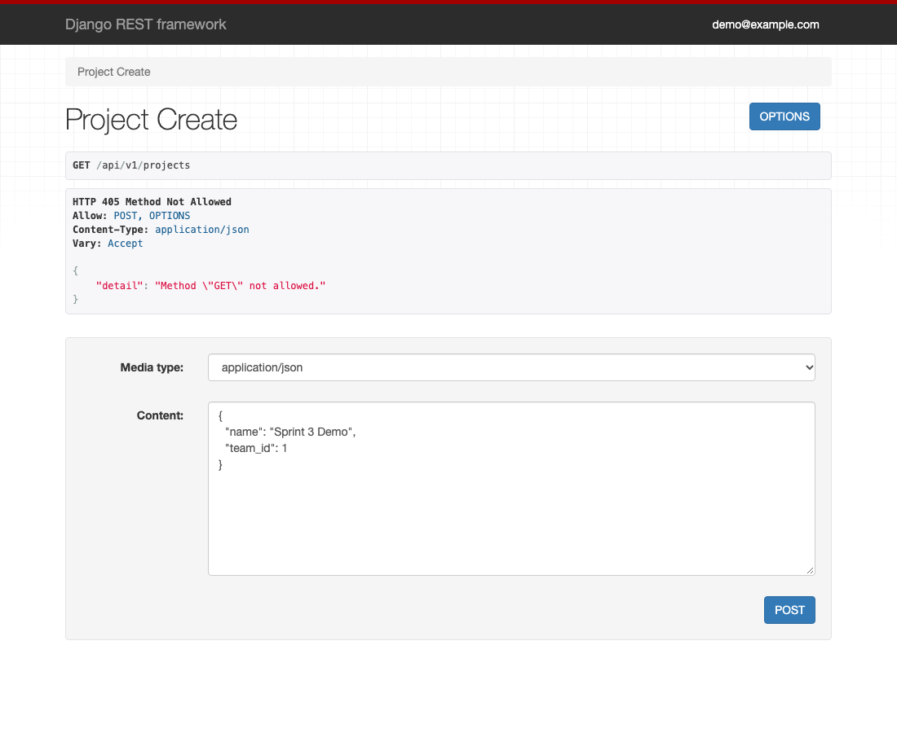
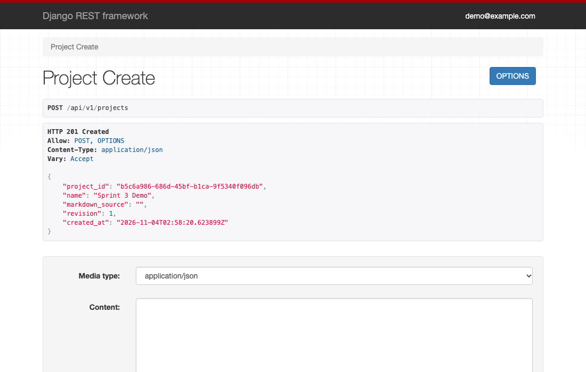
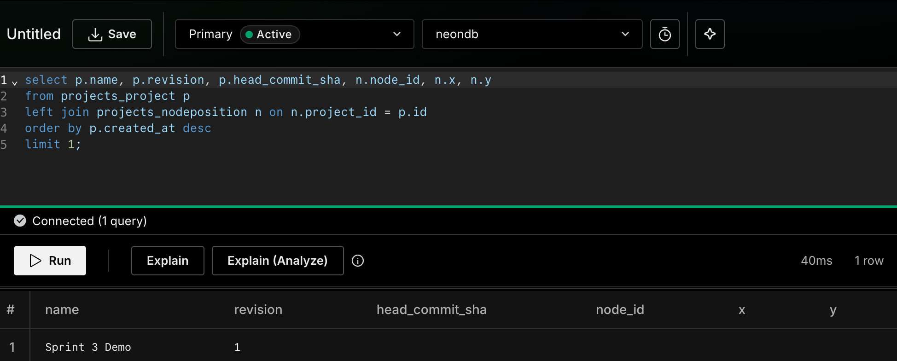

# SE1 Group Project

This repository contains two Django demos that we're keeping separate for this sprint:

- **Dialogue editor:** Write game dialogue in Markdown, turn it into a React Flow graph, and edit nodes and connections. Drafts are stored in a local SQLite database.

- **Accounts, teams, and projects:** Manage email-based user accounts and team memberships through Django admin, and create, open, and save projects through the project API. This demo uses Neon PostgreSQL, and saved Markdown goes to a private GitHub repository.

Both demos use the same source repository, but **they do not share a database**. The dialogue parser and editor do not connect to Neon. We plan to integrate the two systems in a later sprint.

## Requirements

- Python **3.12** (recommended for the team's pinned dependencies)

- Node.js **22.12 or newer**, with npm

- Terminal on macOS or PowerShell on Windows

- A free Neon account and a free GitHub account **only if you're running the accounts and project API demo**

Start in the project root, the folder containing `backend/`, `frontend/`, and `fixtures/`.

## macOS: first-time setup

Open a separate Terminal window for each process you want to run. If you're only working on the dialogue editor, you need Terminals 1 and 2.

### Terminal 1 — Frontend build

```bash
cd frontend
npm install
npm run dev
```

Leave this terminal open. In this project, `npm run dev` runs `vite build --watch`: it builds the React files that Django serves and rebuilds them when you make changes. It doesn't start a separate frontend website.

### Terminal 2 — Dialogue editor (SQLite)

```bash
cd backend
python3 -m venv .venv
source .venv/bin/activate
pip install -r requirements.txt
python manage.py migrate
python manage.py runserver 127.0.0.1:8000
```

Open **http://127.0.0.1:8000/**. The editor does not need Neon credentials.

### Terminal 3 — Accounts and teams (Neon, optional)

The first time, follow [Set up Neon and GitHub](#set-up-neon-and-github), which uses your own free accounts, creates a `.env` file in the **project root**, and starts this server. If your team shares a database, ask the teammate managing it for the `.env` values instead. Do not commit `.env` to Git.

After that, start the server in a new terminal, starting from the project root:

```bash
cd backend
source .venv/bin/activate
python manage.py check --settings=config.settings_neon
python manage.py runserver 127.0.0.1:8001 --settings=config.settings_neon
```

Open **http://127.0.0.1:8001/admin/** and sign in using an existing admin account. The health endpoint is **http://127.0.0.1:8001/api/v1/health/**. The project API runs on this server too; see [Project API](#project-api-neon-demo).

**On a database shared with the team, check with the team before running migrations, creating users, or running tests.**

## Windows: first-time setup (PowerShell)

Open PowerShell terminals from the project root. Use Terminals 1 and 2 for the editor, plus Terminal 3 if you want to run the accounts demo.

### Terminal 1 — Frontend build

```powershell
cd frontend
npm install
npm run dev
```

### Terminal 2 — Dialogue editor (SQLite)

```powershell
cd backend
py -3.12 -m venv .venv
.\.venv\Scripts\Activate.ps1
python -m pip install -r requirements.txt
python manage.py migrate
python manage.py runserver 127.0.0.1:8000
```

Open **http://127.0.0.1:8000/**.

If PowerShell blocks virtual-environment activation, run the following in that terminal and try activating it again:

```powershell
Set-ExecutionPolicy -Scope Process -ExecutionPolicy Bypass
.\.venv\Scripts\Activate.ps1
```

If the `py` launcher is unavailable, use `python -m venv .venv` with an installed Python 3.12 interpreter.

### Terminal 3 — Accounts and teams (Neon, optional)

As on macOS, the first time, follow [Set up Neon and GitHub](#set-up-neon-and-github), which creates a project-root `.env` file and starts this server. If your team shares a database, ask the teammate managing it for the `.env` values instead.

After that, start the server in a new PowerShell terminal, starting from the project root:

```powershell
cd backend
.\.venv\Scripts\Activate.ps1
python manage.py check --settings=config.settings_neon
python manage.py runserver 127.0.0.1:8001 --settings=config.settings_neon
```

Open **http://127.0.0.1:8001/admin/**. Avoid migrations, user creation, and tests against the shared Neon database unless the team has approved them. The project API runs on this server too; see [Project API](#project-api-neon-demo).

## Starting the project again

You don't need to recreate `.venv` or reinstall dependencies every time. Reinstall when `requirements.txt` or `package.json` changes. Run migrations again when new Django migrations are added.

**macOS:**

```bash
# Terminal 1, from project root
cd frontend
npm run dev
```

```bash
# Terminal 2, from project root
cd backend
source .venv/bin/activate
python manage.py runserver 127.0.0.1:8000
```

**Windows PowerShell:**

```powershell
# Terminal 1, from project root
cd frontend
npm run dev
```

```powershell
# Terminal 2, from project root
cd backend
.\.venv\Scripts\Activate.ps1
python manage.py runserver 127.0.0.1:8000
```

If you also want the accounts demo, use a third terminal with the same virtual environment and run:

```bash
python manage.py runserver 127.0.0.1:8001 --settings=config.settings_neon
```

Run that last command from `backend/`. Use `Ctrl+C` to stop either Django server or the frontend watcher.

## Using the dialogue editor

1. Write or edit dialogue in Markdown, then click **Parse Markdown** to build the graph.

2. Click a node to highlight where it came from in Markdown. You can edit its speaker, dialogue, audience, and extra fields.

3. Use **+ New node** to add a node. Connect nodes by dragging between handles or by using the **From**, **To**, and **Type** controls.

4. Select a connection and click **Delete connection** to remove it.

5. Graph edits appear immediately on the canvas but stay in a pending buffer until you click **Parse Markdown**. Then use **Save draft** to save the updated Markdown.

6. Markdown drafts with syntax errors can still be saved. Errors prevent graph generation and report a line number when one is available.

7. Use the layout controls to switch between horizontal and vertical graphs or rotate connection labels.

For example:

```markdown
# Node_Greeting
<!-- category: shop, color: blue -->
Merchant: Welcome, traveler.
Merchant: What can I do for you?
* "Browse the shop" -> Node_Shop

# Node_Shop
Merchant: Take your time.
<<jump: Node_Greeting>>
```

A larger sample is in `fixtures/merchant.md`.

## Project API (Neon demo)

The project API creates, opens, and saves projects. It runs on the Neon server at port 8001, and the dialogue editor does not call it yet. Request and response bodies follow section 4.1 of the Sprint 2 design document.

| Request | Purpose | Responses |
| --- | --- | --- |
| `POST /api/v1/auth/login` | Sign in with an email and password and get a token | `200`, `400`, `401` |
| `POST /api/v1/projects` | Create a project for a team | `201`, `400`, `401`, `403`, `422` |
| `GET /api/v1/projects/<project_id>` | Open a project with its Markdown and node positions | `200`, `401`, `403`, `404`, `503` |
| `PUT /api/v1/projects/<project_id>/save` | Save Markdown and node positions | `200`, `400`, `401`, `403`, `404`, `409`, `503` |

Project requests accept either a sign-in token (`Authorization: Bearer <token>`) or the Django admin session. Tokens expire after one hour.

A save sends the `base_revision` it started from. If another save happened first, the response is `409` and nothing changes.

Opening a project returns Markdown, revision, and node positions from the same saved state. If GitHub cannot return the previous saved Markdown or commit the new content, Save returns `503` and preserves the project's revision, content reference, and node positions. Open returns `503` while GitHub is unavailable.

### Set up Neon and GitHub

This demo uses your own free Neon database and private GitHub repository, so you don't need any credentials from our team. Each project's Markdown is saved as `projects/<project_id>.md` in that repository, with one commit for each save that changes it.

**This repository is public. Never commit `.env` or paste its values anywhere.**

#### 1. Install the backend

Skip this step if you already created `backend/.venv` in Terminal 2. Start in the project root.

macOS:

```bash
cd backend
python3 -m venv .venv
source .venv/bin/activate
pip install -r requirements.txt
```

Windows PowerShell:

```powershell
cd backend
py -3.12 -m venv .venv
.\.venv\Scripts\Activate.ps1
python -m pip install -r requirements.txt
```

Keep this terminal open in `backend/` with the virtual environment active. The steps below use it.

#### 2. Create a Neon database

1. Sign in at <https://console.neon.tech/> and create a new project. Any name and region will do.

2. Open **Connect**, turn off **Connection pooling**, and copy the connection string. You'll use it in step 4.

   

#### 3. Create a private GitHub repository and token

1. Create a **private** repository at <https://github.com/new> and select **Add a README file**, so the `main` branch exists.

2. Under **Settings > Developer settings > Personal access tokens > Fine-grained tokens**, generate a new token. For repository access, choose only the repository you just created. For repository permissions, set **Contents** to **Read and write**.

3. Copy the token. GitHub only shows it once.

#### 4. Create `.env`

Copy the example file to the project root. On Windows, use `Copy-Item ..\.env.example ..\.env`.

```bash
cp ../.env.example ../.env
```

Then fill in these values and leave the others as they are:

| Variable | Value |
| --- | --- |
| `DJANGO_SECRET_KEY` | The output of `python -c "import secrets; print(secrets.token_urlsafe(50))"` |
| `DATABASE_URL` | The Neon connection string from step 2 |
| `GITHUB_REPOSITORY` | Your repository from step 3, as `owner/name` |
| `GITHUB_TOKEN` | The token from step 3 |

Without `GITHUB_REPOSITORY`, the API still runs, but it makes no GitHub commits and keeps saved Markdown in server memory. After a restart, opening or saving a project whose Markdown was cleared returns `503`. Project records and node positions stay in the database.

#### 5. Create the tables and an admin account

```bash
python manage.py migrate --settings=config.settings_neon
python manage.py createsuperuser --settings=config.settings_neon
```

Enter an email, display name, and password when asked. The email appears in the commit messages in your repository.

On a database that already has accounts, the `accounts` migration lowercases existing emails. If two accounts differ only by capitalization, it stops with an error that names them and changes nothing.

#### 6. Start the server

```bash
python manage.py runserver 127.0.0.1:8001 --settings=config.settings_neon
```

Leave it running.

#### 7. Sign in and add a team

1. Sign in at <http://127.0.0.1:8001/admin/> with the admin account from step 5.

   

2. Under **Teams > Teams**, add a team.

3. Under **Teams > Team memberships**, add your account to that team.

   

In a new database, the first team's ID is `1`. Otherwise, the ID is the number in the team's admin page URL.

### Run the demo

Use the same browser you signed in with. The API pages first show `405` because the browser sends GET, and that's expected. To send a request, use the form at the bottom of the page with **Media type** set to `application/json`.

#### 1. Create a project

Open <http://127.0.0.1:8001/api/v1/projects>, paste this into the form, and click **POST**:

```json
{
  "name": "Sprint 3 Demo",
  "team_id": 1
}
```



**Expected:** `201 Created`, with a new `project_id`, an empty `markdown_source`, and `revision: 1`. Copy the `project_id` and use it in place of `<project_id>` below.



#### 2. Check the project in Neon

In the Neon console, open **SQL Editor** and run:

```sql
select p.name, p.revision, p.head_commit_sha, n.node_id, n.x, n.y
from projects_project p
left join projects_nodeposition n on n.project_id = p.id
order by p.created_at desc
limit 1;
```

**Expected:** `Sprint 3 Demo` at `revision` 1, with `head_commit_sha`, `node_id`, `x`, and `y` empty.



#### 3. Save the project

Open `http://127.0.0.1:8001/api/v1/projects/<project_id>/save`, paste this into the form, and click **PUT**:

```json
{
  "markdown_source": "# Node_1\nHello from Team 6!\n",
  "layout_data": {
    "nodes": [
      {
        "id": "Node_1",
        "position": {"x": 120, "y": 300}
      }
    ]
  },
  "base_revision": 1
}
```

**Expected:** `200 OK`, with `status: "saved"` and `revision: 2`.

#### 4. See the commit on GitHub

Open your repository's commit list.

**Expected:** The newest commit is `Save Sprint 3 Demo (<project_id>) revision 2 by <your email>`, and it adds `projects/<project_id>.md`.

#### 5. Check Neon again

Run the same query in **SQL Editor**.

**Expected:** `revision` 2, a `head_commit_sha` that matches the GitHub commit, and `Node_1`, `120`, `300`.

#### 6. Open the project

Open `http://127.0.0.1:8001/api/v1/projects/<project_id>`.

**Expected:** `200 OK`, with `Hello from Team 6!` in `markdown_source`, position `120.0`, `300.0`, and `revision: 2`.

#### 7. Try an outdated save

Open the save page from step 3 again, paste this into the form, and click **PUT**:

```json
{
  "markdown_source": "# Node_1\nThis change should be rejected.\n",
  "layout_data": {
    "nodes": [
      {
        "id": "Node_1",
        "position": {"x": 120, "y": 300}
      }
    ]
  },
  "base_revision": 1
}
```

**Expected:** `409 Conflict`, with `revision: 2`. Run the query in **SQL Editor** again, and `revision` and `head_commit_sha` are unchanged.

#### 8. Restart the server and open the project again

Press `Ctrl+C` in the server terminal, run the command from step 6 of the setup again, and reload the page from step 6 above.

**Expected:** The same Markdown and `revision: 2`. You stay signed in.

#### 9. Run the tests

In a new terminal, activate the virtual environment from `backend/` and run:

```bash
python manage.py test accounts teams config projects --settings=config.settings_auth_test
```

**Expected:** `Ran 63 tests` and `OK`. These tests use a temporary SQLite database, not Neon or GitHub.

### Sign in with a token

The login endpoint returns a token plus the teams you belong to and their projects. Send the token in an `Authorization: Bearer` header instead of using the admin session. Use an account that is on a team, as in step 7 of the setup.

#### 1. Sign in

macOS:

```bash
curl -s -X POST http://127.0.0.1:8001/api/v1/auth/login \
  -H "Content-Type: application/json" \
  -d '{"email": "you@example.com", "password": "your-password"}'
```

Windows PowerShell:

```powershell
$login = Invoke-RestMethod -Method Post -Uri http://127.0.0.1:8001/api/v1/auth/login -ContentType "application/json" -Body (@{email="you@example.com"; password="your-password"} | ConvertTo-Json)
$login | ConvertTo-Json -Depth 5
```

**Expected:** `200 OK` with a `token`, `user_id`, `name`, `email`, and `teams`. Capitalization in the email doesn't matter.

```json
{
  "token": "<token>",
  "user_id": 1,
  "name": "Designer",
  "email": "designer@example.com",
  "teams": [
    {
      "team_id": 1,
      "name": "Team 6",
      "projects": [
        {"project_id": "<project_id>", "name": "Sprint 3 Demo", "revision": 2, "updated_at": "<time>"}
      ]
    }
  ]
}
```

#### 2. Use the token

macOS (replace `<token>` with the token from step 1):

```bash
curl -s -X POST http://127.0.0.1:8001/api/v1/projects \
  -H "Content-Type: application/json" \
  -H "Authorization: Bearer <token>" \
  -d '{"name": "Token Demo", "team_id": 1}'
```

Windows PowerShell:

```powershell
Invoke-RestMethod -Method Post -Uri http://127.0.0.1:8001/api/v1/projects -ContentType "application/json" -Headers @{Authorization="Bearer $($login.token)"} -Body '{"name": "Token Demo", "team_id": 1}'
```

**Expected:** `201 Created`.

#### 3. Try the failures

| Request | Response |
| --- | --- |
| Wrong password, or an email that is not registered | `401`, no token, and the same message for both |
| Email or password missing or blank | `400`, naming the missing field |
| Missing, invalid, or expired token on a project request | `401`, no project data |
| Valid token, but the user is not on the project's team | `403` |

### If something goes wrong

| What you see | What to do |
| --- | --- |
| `Set the DJANGO_SECRET_KEY` | Create `.env` in the project root, not in `backend/`. See step 4 of the setup. |
| `401` | Send a token from `POST /api/v1/auth/login` as `Authorization: Bearer <token>`, or sign in at <http://127.0.0.1:8001/admin/> in the same browser. |
| `403` and `You are not a member of this team.` | Check `team_id`, and add your account under **Teams > Team memberships**. |
| `405` | This is expected when you first open an API page. Use the form at the bottom. |
| `409` | `base_revision` is out of date. Use the latest `revision` from the API. |
| `503` | Check `GITHUB_REPOSITORY` and `GITHUB_TOKEN`. Without GitHub configured, this also happens after a restart. |

## Demo data

- **Editor:** a new browser session opens with the sample in `fixtures/merchant.md`.

- **Project API:** add one team and one membership in the admin, as in step 7 of [Set up Neon and GitHub](#set-up-neon-and-github). There is no seed command.

## Tests

Run these checks before merging or pushing changes. The editor tests use SQLite, and the accounts, teams, and project tests use a separate temporary SQLite test database. **None of the commands below require Neon credentials or modify the shared Neon database.** They do not verify a live Neon connection.

### macOS — run all primary tests

Start in the repository root (`SE1_GroupProject`), with the Python and Node.js dependencies installed as described above:

```bash
# Backend: Django editor, Markdown parser, and graph generation
cd backend
source .venv/bin/activate
python manage.py test editor -v 2
python -m unittest discover -s tests -p 'test_*.py' -v

# Accounts, teams, and project API: isolated SQLite, never Neon
python manage.py test accounts teams config projects --settings=config.settings_auth_test

# Frontend: TypeScript, React Flow tests, and production build
cd ../frontend
npm run typecheck
npm test
npm run build
```

### Windows PowerShell — run all primary tests

Start in the repository root (`SE1_GroupProject`):

```powershell
# Backend tests
cd backend
.\.venv\Scripts\Activate.ps1
python manage.py test editor -v 2
python -m unittest discover -s tests -p 'test_*.py' -v
python manage.py test accounts teams config projects --settings=config.settings_auth_test

# Frontend tests
cd ..\frontend
npm run typecheck
npm test
npm run build
```

The `editor` tests cover the Django editor endpoints, draft saving, validation, and CSRF protections. The Python `unittest` command tests Markdown parsing and graph generation. `npm test` checks TypeScript graph mapping and source-selection helpers; `npm run typecheck` catches TypeScript errors, and `npm run build` verifies that the frontend compiles.

The `projects` tests cover creating, opening, and saving projects, revision conflicts, team access, malformed layouts, and storage failures. Regression tests cover consistent snapshots during interleaved saves and unchanged project data after failures to read the previous saved Markdown. GitHub storage tests use a simulated GitHub API: commits, reading earlier versions, position-only saves without a commit, GitHub errors, and a database failure after a commit.

The `accounts` tests also cover sign-in tokens, Bearer authentication, the login endpoint, and the teams list returned at login.

If your Python virtual environment is missing, create it from `backend/` (`python3 -m venv .venv` on macOS) and install packages with `python -m pip install -r requirements.txt`. If frontend dependencies are missing, run `npm ci` in `frontend/` before rerunning the checks.

### Browser integration tests (optional)

From `frontend/`, install the Playwright Chromium browser if needed and run:

```bash
npx playwright install chromium
npm run test:e2e
```

The browser tests exercise the actual editor UI. Depending on the Playwright configuration, you may need to have Django serving the editor at `http://127.0.0.1:8000/`, plus the Vite build watcher, before running them.

**After testing:** `npm run build` can regenerate the tracked files under `backend/editor/static/editor/dist/`. Use `git status` from the repository root to review those changes before committing; generated files are not necessarily source-code changes.

## Main files

| File or folder | Purpose |
| --- | --- |
| `backend/config/settings.py` | Dialogue editor configuration: SQLite, editor app, and local settings. |
| `backend/config/urls.py` | Dialogue editor routes. |
| `backend/config/settings_neon.py` | Separate Neon configuration for accounts, teams, and projects. |
| `backend/config/urls_neon.py` | Neon demo routes for Django admin, the health endpoint, and the project API. |
| `backend/config/settings_auth_test.py` | SQLite-only test configuration for accounts, teams, and projects. |
| `backend/accounts/` | Custom email-based user model, admin, token sign-in, and tests. |
| `backend/teams/` | Team and membership models, admin, and tests. |
| `backend/projects/` | Project API, node positions in Neon, Markdown storage in GitHub, and tests. Runs with the Neon configuration. |
| `backend/editor/` | Editor page, draft saving, and parse endpoints. |
| `backend/dialogue_graph/` | Markdown parsing, validation, and graph generation. |
| `frontend/src/main.tsx` | Editor controls, API requests, and graph-editing actions. |
| `frontend/src/components/` | React Flow graph, custom nodes, and edges. |
| `frontend/src/graph/toFlow.ts` | Graph layout and edge routing. |
| `fixtures/` | Sample Markdown and expected graph output. |

See `FILE_GUIDE.md` for a more detailed breakdown. `MERGE_NOTES.md` records the original sprint merge approach.

## Troubleshooting

- **`requirements.txt` not found:** Run `pip install -r requirements.txt` inside `backend/`.

- **`manage.py` not found:** Move into `backend/` before running Django commands.

- **Vite says `build --watch`:** That's expected. Open the editor through Django at port 8000, not a Vite URL.

- **Frontend changes aren't showing up:** Check the Vite terminal for errors and refresh your browser.

- **Port already in use:** Stop the older server before restarting it. The editor is intended for port 8000; accounts uses 8001.

- **TypeScript reports missing CSS or Vite declarations:** Run `npm install` in `frontend/`, then restart the TypeScript server in your editor.

- **Neon demo doesn't start:** Check that `.env` exists in the project root and contains valid credentials. Do not post credentials in chat or commit them to the repository.

## Current limitations

The Markdown parser is still a regex-based prototype, not the planned Lark implementation. It handles basic dialogue, choices, jumps, conditions, and metadata, but not the full planned language for quests, characters, inventories, and complex state.

The dialogue editor does not yet use login, team membership permissions, or a Neon project model. Draft ownership is based on a browser session and stored locally in SQLite. Node positions are not permanently saved, and cross-file links are not implemented yet. JSON graph data exists, but a separate JSON download/export feature is still planned.

The accounts demo uses Django admin, not a custom user-facing login page. Integration with the editor is planned for a future sprint.

The project API saves Markdown and node positions, but the editor does not call it yet, so the editor's drafts and node positions stay as described above. The API uses the Django admin session for login, because the login endpoint is not built yet. Save does not run the parser yet, so `diagnostics` is always empty and positions of deleted nodes are kept. Repository writes run one at a time within one server process.

This setup is for local development and demos, not public deployment.
