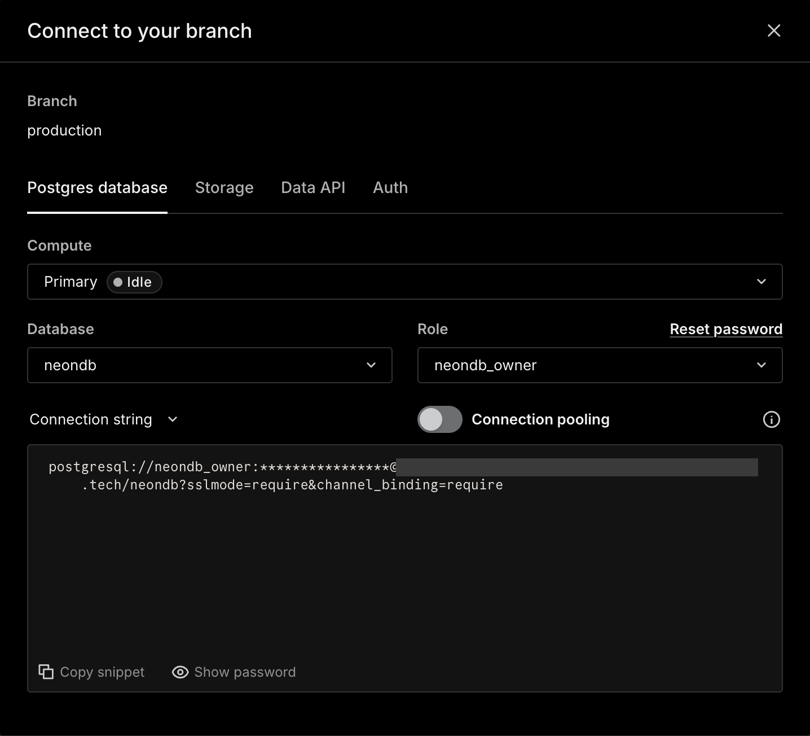
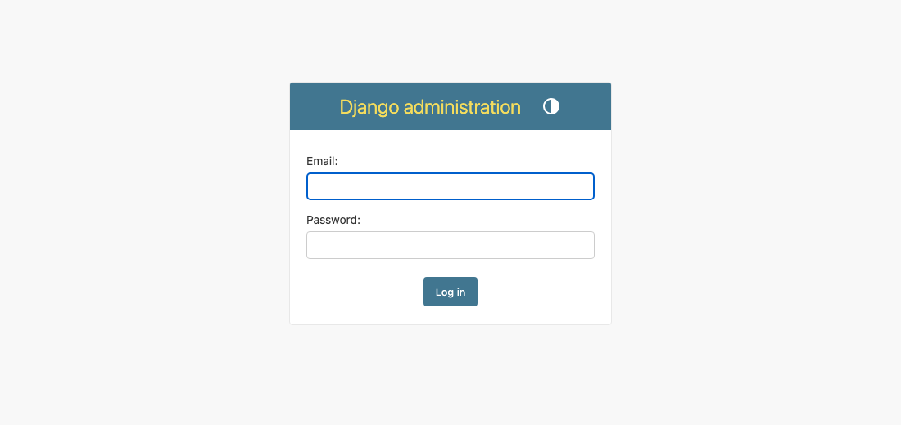
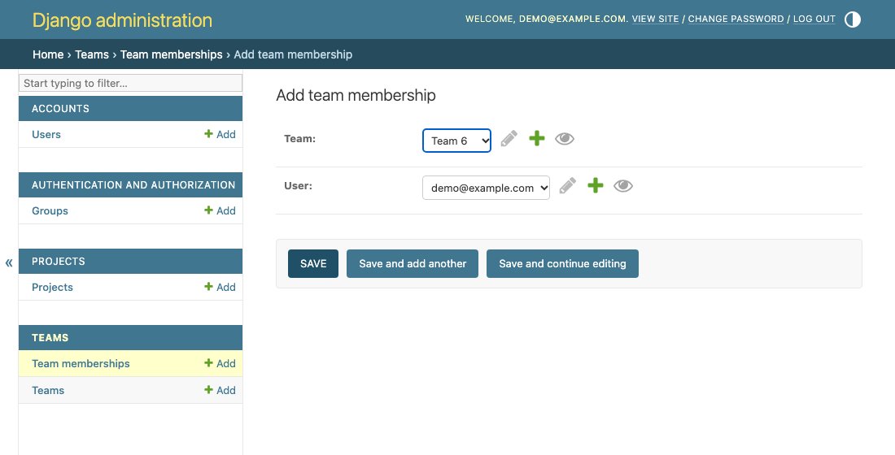

# Dialogue Scripting Tool

A browser editor for writing dialogue as Markdown and arranging it as a node graph.
Register, create a project, edit its dialogue, and save its text and node positions.
Neon stores accounts, teams, projects, and node positions; a private GitHub repository stores Markdown and its history.

People using the editor only register and log in. The database and repository below are for whoever runs the backend. By default each developer sets up their own, so one person's data never reaches another's. To skip that, see [Optional: use a shared `.env`](#optional-use-a-shared-env).

## Quick start

### Before you start

Install Python **3.12** and Node.js **22.12 or newer** (with npm). Create free [Neon](https://console.neon.tech/) and [GitHub](https://github.com/) accounts.
Open one terminal in the repository root: the folder containing `backend/`, `frontend/`, and `.env.example`. Keep this terminal open through all six steps.

### 1. Install dependencies and build the frontend

From the repository root, run:

```bash
./setup.sh
```

<details>
<summary>Windows PowerShell</summary>

```powershell
.\setup.ps1
```

If PowerShell blocks the script, run `Set-ExecutionPolicy -Scope Process -ExecutionPolicy Bypass` in this terminal, then repeat the command.
</details>

**You should see:** package installation completes, Vite reports `built in`, and the script ends with `Setup finished`. It needs no `.env` and touches no database. Run it again after you pull new code and after dependencies change, because the built frontend is not in Git.

### 2. Create your Neon database

In the Neon console, create a project for your own development. Open **Connect**, select your database, turn **Connection pooling** off, and copy the connection string for step 4. [Neon connection guide](https://neon.com/docs/connect/connect-from-any-app).



**You should see:** a connection string starting with `postgresql://`, with `sslmode=require` and no `-pooler` in the hostname.

### 3. Create your private GitHub repository and token

In your browser, [create a private repository](https://github.com/new) under your own account, separate from this source repository. Enable **Add a README file** to create its `main` branch.
Open **Settings > Developer settings > Personal access tokens > Fine-grained tokens** and generate a token. Select your account as **Resource owner**, choose **Only select repositories**, and select the new repository. Set **Contents** to **Read and write**, then copy the token for step 4. [GitHub token guide](https://docs.github.com/en/authentication/keeping-your-account-and-data-secure/managing-your-personal-access-tokens).

The app does not start without this repository and token. A database and its repository belong together, because the database's paths and commit SHAs only make sense in that repository. Never change one of them and keep the other.

**You should see:** a private repository with a README on `main`, and a token with access to that repository.

### 4. Create `.env` and check the settings

Copy the template and generate a secret key:

```bash
cd backend
source .venv/bin/activate
cp ../.env.example ../.env
python -c "import secrets; print(secrets.token_urlsafe(50))"
```

<details>
<summary>Windows PowerShell</summary>

```powershell
cd backend
.\.venv\Scripts\Activate.ps1
Copy-Item ../.env.example ../.env
python -c "import secrets; print(secrets.token_urlsafe(50))"
```
</details>

The last command prints a new value each time and changes nothing. Generate it once for your environment and keep it: changing it later signs everyone out.

Open `.env` in the repository root and fill in:

| Variable | Value |
| --- | --- |
| `DJANGO_SECRET_KEY` | The generated secret key |
| `DATABASE_URL` | The Neon connection string from step 2 |
| `GITHUB_REPOSITORY` | Your private repository as `owner/name` |
| `GITHUB_TOKEN` | The token from step 3 |

Keep `DJANGO_DEBUG=True` for local static files and login cookies over HTTP. Keep `GITHUB_BRANCH=main` and the supplied `DJANGO_ALLOWED_HOSTS`.
**This repository is public. Never commit `.env`, and never paste its values into a document, screenshot, or chat.**

From `backend/`, run this command on both platforms:

```bash
python manage.py check --settings=config.settings_neon
```

**You should see:** `System check identified no issues`. A missing value, or the template's secret key, is named here instead. Steps 5 and 6 check the database and GitHub connections.

### 5. Create the tables and start the service

Confirm that `DATABASE_URL` is your own development database. From `backend/`, with the Python environment active, run on both platforms:

```bash
python manage.py migrate --plan --settings=config.settings_neon
python manage.py migrate --settings=config.settings_neon
cd ..
```

Then start the app:

```bash
./start.sh
```

<details>
<summary>Windows PowerShell</summary>

```powershell
.\start.ps1
```
</details>

The start script checks the configuration and pending migrations, then runs the full app. Neither script ever migrates a database: when `start` reports pending migrations, run `migrate` as above.

**You should see:** migrations marked `OK` (or `No migrations to apply`), then `Starting development server at http://127.0.0.1:8000/`. Leave this terminal running and open [the app](http://127.0.0.1:8000/). The first page is **Log in**.

### 6. Create and save your first project

In the browser, choose **Create an account**, enter your details, and submit. Registration creates your personal team.
**You should see:** **Your projects**, your team, and a **New project** form.

Enter `My first dialogue` as the project name and click **Create project**.
**You should see:** an empty Markdown box and an empty graph.

Paste this into the Markdown box and click **Parse**:

```markdown
<!-- start: Node_Greeting -->
# Node_Greeting
<!-- category: shop, color: blue -->
Merchant: Welcome, traveler.
* "Browse the shop" -> Node_Shop

# Node_Shop
Merchant: Take your time.
<<jump: Node_Greeting>>
```

**You should see:** two nodes, two connections, and a **START** label on `Node_Greeting`. Parsing completes without a dialog.

Drag a node, click **Save**, wait for **Saved**, then refresh the page. Open your private GitHub repository and view its commits.
**You should see:** the same Markdown, two nodes, two connections, and the saved positions. GitHub has a commit named `docs(dialogue): create "My first dialogue" r2 by <your display name>`, containing `teams/<team_id>/projects/<project_id>.md`.

## Optional: use a shared `.env`

To skip creating your own database and repository, ask the person who maintains a shared development environment for its complete `.env`. It is kept in the team's private location, never in this repository.

1. Run step 1 of the Quick start.
2. Put the file beside `README.md`. Keep every value in it, including `DJANGO_SECRET_KEY`.
3. Run `./start.sh`, or `.\start.ps1` on Windows.
4. Create your own account in the browser. Do not share accounts: commits show who saved.

**You should see:** the **Log in** page, as in step 5.

Everyone on a shared `.env` uses one database and one repository, each with their own local backend. What you save, and any migration or reset, affects the others. Only the maintainer runs `migrate`: if the start script reports pending migrations, ask them. When the credentials change, replace the file and restart.

## Start again later

If you pulled new code since the last run, run `./setup.sh` first, or `.\setup.ps1` on Windows. Then, from the repository root:

```bash
./start.sh
```

<details>
<summary>Windows PowerShell</summary>

```powershell
.\start.ps1
```
</details>

**You should see:** the server address. Open [the app](http://127.0.0.1:8000/), log in, and choose your project. Its text, graph, and positions load automatically. Stop the server with `Ctrl+C`.

## Using the editor

- **Parse** builds the graph. Editing Markdown clears the old graph until you parse again.
- Click a node to mark its source lines and edit its fields. Click a connection to mark its line. Key presses then leave the Markdown alone; click in the Markdown box to edit it. **×** and **Cancel** close the details and discard changes that are not applied. While such changes exist, clicking an empty part of the graph or another node keeps the details open; otherwise an empty click closes them and a node click switches to that node.
- **+ New node**, connection handles, and the controls under **Connections** edit the graph. **Parse** or **Save** applies those graph edits to Markdown.
- **Save** stores Markdown and positions. Each successful save advances the revision. A Markdown change also creates a GitHub commit under your display name; moving nodes alone does not.
- Invalid Markdown can be saved. Parse shows errors and source lines to fix.
- **Starting nodes** selects conversation entry nodes. **Layout**, under **View**, switches between horizontal and vertical graphs.
- Drag the line between the two panels to resize them. Double-click it to restore the default width.
- `Ctrl`/`⌘` + `Enter` parses; `Ctrl`/`⌘` + `S` saves.
- With unsaved text, graph edits, or moved nodes, **← Projects** asks whether to save or discard. Closing the tab, refreshing, and **Log out** use the browser's own prompt instead.

Use `# Node_ID` for a node, `Speaker: text` for dialogue, `* "Choice" -> Node_ID` for a choice, and `<<jump: Node_ID>>` for a jump. Put `<!-- start: Node_ID -->` before the first heading to mark a starting node. See [the merchant sample](fixtures/merchant.md) for a larger dialogue.

### Changing the frontend

In a second terminal, from `frontend/`, run `npm run dev` on either platform. It rebuilds files when you edit them. Refresh the Django page after a build.
**You should see:** Vite watching for file changes. Run `npm ci` after dependency changes; run `npm run build` for a single build.

## Run the tests

**Never run tests with `config.settings_neon`.** Use the commands below from the repository root. They use local SQLite databases and memory storage.

```bash
cd backend
source .venv/bin/activate
python manage.py test accounts teams config projects --settings=config.settings_auth_test
python manage.py test editor --settings=config.settings
python -m unittest discover -s tests -p 'test_*.py'
cd ../frontend
npm run typecheck
npm test
npm run build
npx playwright install chromium
npm run test:e2e
```

<details>
<summary>Windows PowerShell</summary>

```powershell
cd backend
.\.venv\Scripts\Activate.ps1
python manage.py test accounts teams config projects --settings=config.settings_auth_test
python manage.py test editor --settings=config.settings
python -m unittest discover -s tests -p 'test_*.py'
cd ../frontend
npm run typecheck
npm test
npm run build
npx playwright install chromium
npm run test:e2e
```
</details>

**You should see:** Python tests finish with `OK`, frontend tests pass, typecheck exits successfully, and Playwright reports all tests passed.
Playwright starts its own services: the existing editor tests use port 8765; project tests use port 8766 with `config.settings_e2e`. Their ignored `.sqlite3` files persist between runs. Project tests create unique accounts each time.

For a manual browser check without cloud services, use `config.settings_e2e`. From `backend/`, with the Python environment active and the frontend built:

```bash
export DJANGO_DATABASE_PATH="$PWD/manual-e2e.sqlite3"
python manage.py migrate --settings=config.settings_e2e
python manage.py runserver 127.0.0.1:8766 --settings=config.settings_e2e
```

<details>
<summary>Windows PowerShell</summary>

```powershell
$env:DJANGO_DATABASE_PATH = "$PWD/manual-e2e.sqlite3"
python manage.py migrate --settings=config.settings_e2e
python manage.py runserver 127.0.0.1:8766 --settings=config.settings_e2e
```
</details>

**You should see:** the login page at [port 8766](http://127.0.0.1:8766/). This mode uses SQLite and memory storage; saved Markdown lasts for one server run. Close this terminal when finished.

### Saves from several backends

SQLite and memory storage cannot prove the locks between backend processes. [This check](backend/tests/integration/check_concurrent_saves.py) starts two backends on a local PostgreSQL database and a test branch of a private repository. Its first lines explain the setup. Never point it at a database or branch that holds real data.

**You should see:** `All integration checks passed.`

## If something goes wrong

| What you see | What to do |
| --- | --- |
| `(projects.E001)` with a setting's name | Fill in that value in `.env`, beside `README.md`, as in step 4. With a shared `.env`, check the file you received. Start again. |
| `The database has unapplied migrations` | In your own environment, confirm `DATABASE_URL` and run `migrate` as in step 5. With a shared `.env`, ask its maintainer. |
| `Could not read the database` | Replace `DATABASE_URL` with the direct connection string from Neon Connect, including `sslmode=require`, then start again. |
| The merchant example opens without login | Stop the server and run `./start.sh`, or `.\start.ps1` on Windows. |
| `Frontend assets are missing` | Run `./setup.sh`, or `.\setup.ps1` on Windows, then refresh. |
| `Project storage is not available right now` | Correct `GITHUB_REPOSITORY`, `GITHUB_TOKEN`, and `GITHUB_BRANCH` in `.env`. Give the token Contents read and write access. Restart the server and retry Save. Your text stays on the page. This also appears when another save holds the branch for over 15 seconds; then just retry. |
| `You do not belong to a team yet` | Add the account under **Teams > Team memberships** in Django admin, then refresh the home page. |
| `Error: That port is already in use.` | Press `Ctrl+C` in the terminal running the earlier server, then start this service again. |

## Reference

### Settings

| Module | Use |
| --- | --- |
| `config.settings_neon` | Local app with accounts, teams, projects, Neon, and GitHub |
| `config.settings_auth_test` | Automated account and project tests with temporary SQLite |
| `config.settings_e2e` | Browser checks with file-based SQLite and memory storage |
| `config.settings_integration` | Lock checks with a local PostgreSQL and a test branch |
| `config.settings` | Old SQLite editor demo and its tests; `manage.py` default |

`manage.py` alone starts the old demo, so include `--settings=config.settings_neon` when you run it for the full app. Only the test settings use memory storage.

### Main files

| Path | Purpose |
| --- | --- |
| [setup.sh](setup.sh), [setup.ps1](setup.ps1) | Install dependencies and build the frontend |
| [start.sh](start.sh), [start.ps1](start.ps1) | Check the configuration and start the full app |
| [backend/accounts/](backend/accounts/) | Email accounts, token login, and registration |
| [backend/teams/](backend/teams/) | Teams and membership |
| [backend/projects/](backend/projects/) | Project pages, API, positions, and GitHub storage |
| [backend/config/](backend/config/) | Settings and shared routes |
| [backend/editor/](backend/editor/) | Editor page, assets, and parse endpoint |
| [backend/dialogue_graph/](backend/dialogue_graph/) | Markdown parser and graph validation |
| [frontend/src/main.tsx](frontend/src/main.tsx) | Editor controls and graph edits |
| [frontend/src/project/](frontend/src/project/) | Loading, saving, positions, and unsaved state |
| [frontend/src/components/](frontend/src/components/) | Graph, nodes, and edges |
| [frontend/e2e/](frontend/e2e/) | Browser tests |

### Sign-in and project API

The login page sends the email and password to `POST /api/v1/auth/login`. It returns a token that lasts 8 hours. Because the login page also sends its CSRF token, the reply stores the token in an httpOnly cookie. The pages, `/sync`, and the project API read that cookie; writes from the browser also send the CSRF token. Scripts get the token without a cookie, send it as `Authorization: Bearer <token>`, and need no CSRF token. A Django admin login in the same browser also works for project requests, but not for the pages.

| Request | Result |
| --- | --- |
| `POST /api/v1/auth/login` | Sign in with `email` and `password`; returns `token`, `user`, and `teams` with their projects |
| `POST /api/v1/projects` | Create with `name` and `team_id`; returns `201` |
| `GET /api/v1/projects/<project_id>` | Read Markdown, `revision`, and `layout_data` |
| `PUT /api/v1/projects/<project_id>/save` | Send `markdown_source`, `layout_data.nodes`, and `base_revision`; returns the new revision |
| `GET /api/v1/projects/<project_id>/export` | Compile the saved Markdown into the JSON AST download (US-25); returns `422` with a timestamped error log when the Markdown has errors |

A stale save returns `409`. Failed storage reads or writes return `503`, as does waiting too long for another save to the same branch. The editor displays the reason and keeps unsaved text available.

#### Use a token from a terminal

Start the app first. Sign in with your account:

```bash
curl -s -X POST http://127.0.0.1:8000/api/v1/auth/login \
  -H "Content-Type: application/json" \
  -d '{"email": "you@example.com", "password": "your-password"}'
```

<details>
<summary>Windows PowerShell</summary>

```powershell
$login = Invoke-RestMethod -Method Post -Uri http://127.0.0.1:8000/api/v1/auth/login -ContentType "application/json" -Body (@{email="you@example.com"; password="your-password"} | ConvertTo-Json)
$login | ConvertTo-Json -Depth 5
```
</details>

**You should see:** a `token`, your `user` (`id`, `name`, `email`), and your `teams` with their projects. Capitalization in the email does not matter.

Create a project with the token, using a `team_id` from that reply:

```bash
curl -s -X POST http://127.0.0.1:8000/api/v1/projects \
  -H "Content-Type: application/json" \
  -H "Authorization: Bearer <token>" \
  -d '{"name": "Token Demo", "team_id": <team_id>}'
```

<details>
<summary>Windows PowerShell</summary>

```powershell
Invoke-RestMethod -Method Post -Uri http://127.0.0.1:8000/api/v1/projects -ContentType "application/json" -Headers @{Authorization="Bearer $($login.token)"} -Body (@{name="Token Demo"; team_id=$login.teams[0].team_id} | ConvertTo-Json)
```
</details>

**You should see:** the new project's `project_id` and `revision` 1. It also appears on your home page.

| Request | Response |
| --- | --- |
| Wrong password, or an email that is not registered | `401`, `Invalid email or password.`, and no token |
| Email or password missing or blank | `400`, naming the missing field |
| Missing, invalid, or expired token on a project request | `401`, no project data |
| Valid token, but the user is not on the project's team | `403` |

### What the content repository holds

Each project is one file, `teams/<team_id>/projects/<project_id>.md`, holding only its Markdown. The path never changes, and renaming a project or team does not move it. Only a change to the text creates a commit:

| Field | Value |
| --- | --- |
| Title | `docs(dialogue): create "Act 1" r2 by Leyan`, or `update` once the project has saved text |
| Author | The saver's display name, with `user-<id>@dialogue.invalid` as a fixed identifier that receives no mail |
| Committer | The GitHub account that owns the token |

The revision in a title can skip numbers, because saving only positions also advances it. A commit is not proof of a successful save: the database's commit SHA decides which version opens. The app does not import direct edits to the repository, and its next save can overwrite them, so do not fix dialogue on GitHub.

### Inspect the latest project in Neon

Run this read-only query in the Neon **SQL Editor**:

```sql
select p.id, p.name, p.revision, p.head_commit_sha, n.node_id, n.x, n.y
from projects_project p
left join projects_nodeposition n on n.project_id = p.id
where p.id = (select id from projects_project order by created_at desc limit 1)
order by n.node_id;
```

**You should see:** one row per saved node, with the project's revision, GitHub commit SHA, and coordinates.

### Add another person to a team

From `backend/`, with the Python environment active, run `python manage.py createsuperuser --settings=config.settings_neon` on either platform and enter the requested details.
**You should see:** `Superuser created successfully.` Start the service with the Quick start command, then sign in at [Django admin](http://127.0.0.1:8000/admin/).



The other person first registers in the app. Under **Teams > Team memberships**, select their account and your team, then save.
**You should see:** the new membership. That person can now open your team's projects.



### Reset an environment's data

These commands run only by hand, and nothing in setup, start, migrate, or the tests calls them. Stop every backend using the environment first. Each command must name its target, and it stops if the loaded `.env` points anywhere else.

From `backend/`, with the Python environment active:

```bash
python manage.py reset_inventory --database-host HOST --database-name NAME --repository OWNER/NAME --branch BRANCH --output PRIVATE/manifest.json --backup PRIVATE/backup.dump --settings=config.settings_neon
python manage.py reset_dialogue_data --database-host HOST --database-name NAME --repository OWNER/NAME --branch BRANCH --manifest PRIVATE/manifest.json --result PRIVATE/result.json --settings=config.settings_neon
```

**You should see:** `reset_inventory` lists the rows and exact files to clear, and changes nothing. `pg_dump` must be installed for the backup. Keep `PRIVATE` outside this repository, because the files list private project data. `reset_dialogue_data` shows what it would do until you add `--execute`. With `--execute`, it refuses a manifest made without `--backup`, or whose backup file is missing or has changed since.

A reset removes the app's files in one ordinary commit, then clears accounts, teams, projects, positions, sessions, and admin logs in one transaction. It keeps the Git history, other files, the schema, migrations, permissions, and ID sequences. It stops if the database or branch changed after the inventory. To recover, restore the backup with `pg_restore` and run `restore_dialogue_files` with the same target and manifest: the two sides must match.

After a reset nobody can sign in. Everyone registers again, and someone must run `createsuperuser` again, as in [Add another person to a team](#add-another-person-to-a-team), before anyone can use Django admin.

### Old SQLite demo

From `backend/`, with the Python environment active:

```bash
python manage.py migrate --settings=config.settings && python manage.py runserver 127.0.0.1:8000 --settings=config.settings
```

<details>
<summary>Windows PowerShell</summary>

```powershell
python manage.py migrate --settings=config.settings
python manage.py runserver 127.0.0.1:8000 --settings=config.settings
```
</details>

**You should see:** the merchant editor at port 8000. This old demo will be removed later.

### Current limitations

- The parser uses a regex prototype. The planned Lark parser and full dialogue language are pending.
- Export compiles the last saved revision; the editor asks to save unsaved changes first. The JSON has no top-level `variables` list yet, because the dialogue script has no variable declarations. `[set: ...]` lines are exported in each node's `sequence`.
- Save stores text and positions without running the parser. Its `diagnostics` stays empty; positions for deleted nodes remain stored.
- Layout direction resets when a project reopens.
- Browsers do not allow a custom dialog when a tab closes. Only **← Projects** offers save or discard; other ways of leaving use the browser's built-in prompt.
- Write the first node of a new project in Markdown before adding more nodes through the graph.
- **Log out** clears the cookie in that browser only. A token copied elsewhere stays valid until it expires.
- The service targets local development and demos. Registration is open.
